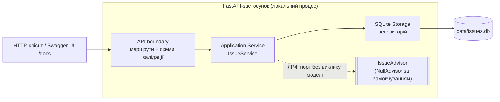
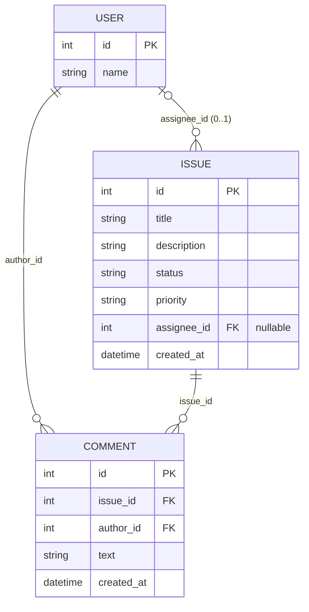

# Mini Issue Tracker — архітектура (ЛР1)

Правила поведінки — `requirements.md`; маршрути й коди — `api-contract.md`.

## 1. Схема компонентів



| Компонент | Відповідальність | Не робить |
|---|---|---|
| API boundary (`app/api.py`, `app/schemas.py`) | Перевіряє форму входу: типи, обов'язковість, enum, межі, невідомі поля, порожній PATCH (R-05); перетворює результати й доменні винятки на HTTP-відповіді за `api-contract.md` §2 | Не знає переходів статусів і правил закритої заявки |
| Application Service (`app/service.py`) | Бізнес-правила: переходи §7, заборона редагування CLOSED §7.1, семантика PATCH §8, фільтрація AND, перевірка існування заявки; керує транзакцією | Не формує HTTP-коди, не виконує SQL напряму |
| SQLite Storage (`app/storage.py`) | Створення схеми, початкове заповнення користувачів, CRUD, `ORDER BY created_at, id`, зовнішні ключі, транзакції | Не містить бізнес-правил |
| IssueAdvisor (порт ЛР4, `app/advisor.py`) | Інтерфейс `recommend(title, description) -> Recommendation`; у ЛР1–ЛР3 лише `NullAdvisor` | Не записує дані заявки (ADR-02) |

**Потік зміни статусу.** API перевіряє `{"status"}` → Service відкриває транзакцію
`BEGIN IMMEDIATE`, читає заявку (немає → 404), перевіряє пару за матрицею T-01–T-09
(заборонено → 409, той самий стан → повернення без запису) → Storage виконує `UPDATE` →
`COMMIT` → API повертає 200 з актуальною заявкою.

## 2. Модель сутностей



Три персистентні сутності; поля й обмеження — `requirements.md` §6. Рекомендація AI (ЛР4)
не зберігається в БД у поточному обсязі.

Запланована схема SQLite (ЛР2):

```sql
PRAGMA foreign_keys = ON;
CREATE TABLE users (
    id   INTEGER PRIMARY KEY,
    name TEXT NOT NULL
);
CREATE TABLE issues (
    id          INTEGER PRIMARY KEY AUTOINCREMENT,
    title       TEXT NOT NULL CHECK (length(title) BETWEEN 3 AND 120),
    description TEXT NOT NULL DEFAULT '' CHECK (length(description) <= 2000),
    status      TEXT NOT NULL DEFAULT 'OPEN' CHECK (status IN ('OPEN','IN_PROGRESS','CLOSED')),
    priority    TEXT NOT NULL DEFAULT 'medium' CHECK (priority IN ('low','medium','high')),
    assignee_id INTEGER NULL REFERENCES users(id),
    created_at  TEXT NOT NULL
);
CREATE TABLE comments (
    id         INTEGER PRIMARY KEY AUTOINCREMENT,
    issue_id   INTEGER NOT NULL REFERENCES issues(id),
    author_id  INTEGER NOT NULL REFERENCES users(id),
    text       TEXT NOT NULL CHECK (length(text) BETWEEN 1 AND 1000),
    created_at TEXT NOT NULL
);
CREATE INDEX idx_issues_filter ON issues(status, priority);
CREATE INDEX idx_comments_issue ON comments(issue_id, created_at, id);
```

`CHECK` дублюють валідацію API як останній захист цілісності; джерело правил — §6.

## 3. Запланована структура коду (ЛР2–ЛР4)

```text
app/main.py        створення FastAPI, підключення маршрутів і обробників помилок
app/api.py         маршрути, перетворення винятків на коди api-contract §2
app/schemas.py     Pydantic-моделі з extra="forbid" і strict-типами
app/service.py     IssueService: правила §7–§9
app/storage.py     SQLite: схема, seed користувачів, запити, транзакції
app/errors.py      доменні винятки IssueNotFound, InvalidTransition, IssueClosed
app/advisor.py     порт IssueAdvisor і NullAdvisor (ЛР4)
tests/conftest.py  тимчасова БД через ISSUES_DB_PATH (NFR-03)
tests/test_*.py    тести з traceability.csv
```

## 4. Architecture Decision Records

### ADR-01. SQLite і локальний запуск

- **Контекст.** Невелика команда, синтетичні дані, демонстрація через REST API на ноутбуці;
  дані мають зберігатися після перезапуску (FR-07); тести мають бути ізольовані (NFR-03).
- **Варіанти.** (1) Зберігання в пам'яті; (2) JSON-файл; (3) SQLite; (4) PostgreSQL у Docker.
- **Обране рішення.** SQLite-файл `data/issues.db`, шлях перевизначається змінною
  `ISSUES_DB_PATH`; модуль `sqlite3` зі стандартної бібліотеки.
- **Причина.** Варіант 1 не виконує FR-07. Варіант 2 не дає транзакцій, тому атомарність
  §8 довелося б реалізовувати вручну. Варіант 4 потребує Docker, який не входить до обсягу,
  і ускладнює NFR-01. SQLite дає транзакції, зовнішні ключі й `CHECK` без окремого сервера.
- **Наслідки / обмеження.** Один процес-записувач; конкурентні записи серіалізуються
  через `BEGIN IMMEDIATE`. Для мережевого багатокористувацького розгортання потрібен
  перегляд рішення; у межах курсу воно не передбачене.

### ADR-02. Відокремлення AI-компонента і Human-in-the-loop

- **Контекст.** FR-08 (ЛР4) вимагає рекомендацій категорії, пріоритету й підсумку;
  рекомендація не повинна змінювати заявку автоматично; ядро має працювати без LLM (NFR-05).
- **Варіанти.** (1) Виклик LLM усередині `create_issue` з автоматичним записом пріоритету;
  (2) окремий порт `IssueAdvisor`, що лише повертає пропозицію; (3) не планувати AI.
- **Обране рішення.** Варіант 2: `IssueService` залежить від інтерфейсу `IssueAdvisor`;
  за замовчуванням підключено `NullAdvisor`. Рекомендацію повертає окремий маршрут
  ЛР4; застосувати її можна лише звичайним `PATCH /issues/{id}`, який ініціює людина.
- **Причина.** Варіант 1 порушує FR-08 і NFR-05, робить тести недетермінованими й
  залежними від мережі. Варіант 3 суперечить FR-08. Порт дозволяє тестувати ядро
  без мережі й підміняти модель у ЛР4 тестовим двійником.
- **Наслідки / обмеження.** У ЛР1–ЛР3 немає реального виклику моделі. Рекомендація може
  бути хибною — рішення ухвалює учасник команди; збої LLM не впливають на FR-01–FR-07.
