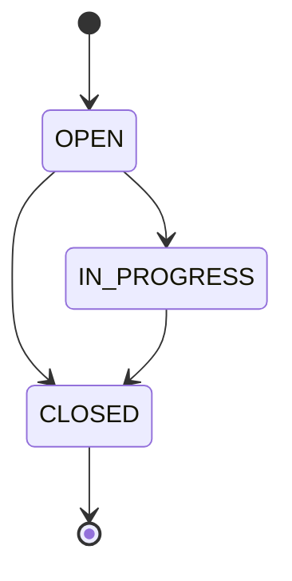

# Mini Issue Tracker — вимоги та контракт даних (ЛР1)

Документ є **єдиним джерелом істини** для моделі даних і бізнес-правил.
`architecture.md`, `api-contract.md`, `traceability.csv` і майбутні тести (ЛР2–ЛР3)
не переформульовують ці правила, а посилаються на розділи цього файлу (§N).

Джерела вимог: вихідний запит замовника, розділ 2 (FR, межі обсягу) і розділ 3
(обов'язкові рішення замовника) завдання ЛР1. Будь-яка зміна наведених там значень
можлива лише через записане рішення про зміну специфікації (§11).

## 1. Вихідний запит і межі обсягу

> Невеликій команді потрібна система для обліку проблем у програмному продукті.
> Користувач створює заявку з назвою й описом. Команда переглядає заявки, призначає
> виконавця, визначає пріоритет, змінює статус і додає коментарі. Хотілося б швидко
> бачити важливі відкриті заявки. У майбутньому система має допомагати автоматично
> визначати категорію та пріоритет звернення.

**Стек:** Python 3.11+, FastAPI, SQLite, pytest. Демонстрація — через REST API та
сторінку документації `/docs`. Один репозиторій на ЛР1–ЛР4.

**Входить до обсягу:** FR-01–FR-07 (реалізація в ЛР2, перевірка в ЛР3);
FR-08 — лише як майбутня історія US-08 (ЛР4).

**Не входить:** реєстрація, паролі, OAuth, рольова авторизація, email-сповіщення,
вкладення, видалення заявок, повнотекстовий пошук, пагінація, складний frontend,
Docker, хмарне розгортання, векторна база, створення користувачів через API.

**Межа ідентифікації.** Користувачі 1 — Agent A і 2 — Agent B є тестовим довідником.
Передавання `assignee_id` чи `author_id` не підтверджує особу; автентифікації немає.
Застосунок працює локально із синтетичними даними.

## 2. Функціональні вимоги

| Код | Можливість | Формалізована межа | Правила |
|---|---|---|---|
| FR-01 | Створення заявки | Клієнт передає `title`, необов'язково `description` і `priority`. Сервер встановлює `id`, `status=OPEN`, `assignee_id=null`, `created_at`. | §6 |
| FR-02 | Перегляд і фільтрація | Список усіх заявок; одна заявка за `id`; фільтри `status`, `priority` окремо або разом (логічне AND). Порожній результат — порожній список. | §6, §10 |
| FR-03 | Часткове редагування | Змінюються лише передані поля з набору `title`, `description`, `priority`, `assignee_id`. Статус — окремою операцією. Невдале редагування атомарне. | §8 |
| FR-04 | Керування статусом | Переходи лише за матрицею §7; помилка не змінює дані; повтор поточного статусу — успіх без змін. | §7 |
| FR-05 | Призначення виконавця | `assignee_id` ∈ {1, 2} або `null` (зняти призначення); виконується через FR-03. | §6, §8 |
| FR-06 | Коментарі | Додавання й перегляд коментарів наявної заявки; автор — 1 або 2; дозволено й для CLOSED. | §6, §7.1, §10 |
| FR-07 | Збереження й валідація | SQLite-файл; дані зберігаються після перезапуску; некоректні запити відхиляються без зміни збережених даних. | §6, §9 |
| FR-08 | Рекомендація AI (лише ЛР4) | Категорія, пріоритет і короткий підсумок; рекомендація не змінює заявку автоматично. | ADR-02 |

## 3. Нефункціональні вимоги

| Код | Вимога | Спосіб перевірки | Майбутній тест / перевірка |
|---|---|---|---|
| NFR-01 | Відтворюваний локальний запуск: з чистого клону на Python 3.11+ застосунок запускається не більше ніж трьома командами з `README.md` (створення venv, `pip install -r requirements.txt`, `uvicorn app.main:app`); `GET /health` повертає 200. | Ручна перевірка в чистому venv іншим учасником; автотест `/health`. | `test_health_ok` |
| NFR-02 | Зрозумілі помилки: кожна відповідь 404/409/422 має тіло формату `{"error": {"code", "message", "details"}}`; для 422 кожен елемент `details` містить `field` і `reason`. | Перевірка структури тіла в усіх негативних тестах. | `test_error_body_format` |
| NFR-03 | Ізоляція тестової бази: тести використовують тимчасовий файл БД, заданий через `ISSUES_DB_PATH`; після прогону `pytest` робочий файл `data/issues.db` не створюється і не змінюється (порівняння SHA-256 до/після). | Фікстура pytest + перевірка хешу. | `test_working_db_untouched` |
| NFR-04 | Відсутність секретів: у репозиторії немає ключів і токенів; `.env` у `.gitignore`, у репозиторії лише `.env.example` без значень. | пошук `git grep -nE "sk-[A-Za-z0-9]{20,}"` і `git grep -niE "api_key *="` повертає порожній результат перед кожним тегом. | ручна перевірка перед тегом |
| NFR-05 | Робота без LLM: FR-01–FR-07 працюють без мережі та без API-ключа; модуль AI (ЛР4) за замовчуванням вимкнений. | Повний прогін тестів FR-01–FR-07 без змінних середовища AI. | `test_core_works_without_ai` |
| NFR-06 | Час у UTC: усі `created_at` повертаються в ISO 8601 із суфіксом `Z`. | Перевірка формату в тестах створення. | `test_created_at_utc_format` |

## 4. Аналіз неоднозначностей (Крок 1)

Список складено кожним учасником без AI до ознайомлення з розділом 3, потім об'єднано
без дублікатів і звірено з рішеннями замовника.

| ID | Фрагмент запиту | Неоднозначність | Чим закрито |
|---|---|---|---|
| A-01 | «створює заявку з назвою й описом» | Межі довжини, обов'язковість опису | Рішення замовника (§3 завдання) → §6 |
| A-02 | «призначає виконавця» | Хто може бути виконавцем, чи можна зняти | Рішення замовника → §6, §8 (P-02) |
| A-03 | «визначає пріоритет» | Шкала й типове значення | Рішення замовника → §6 |
| A-04 | «змінює статус» | Набір статусів і дозволені переходи | Рішення замовника → §7 |
| A-05 | «швидко бачити важливі відкриті» | Що є «важливим» і «відкритим» | FR-02: фільтр `status=OPEN&priority=high`; D-09 |
| A-06 | «додає коментарі» | Хто автор, довжина, чи можна для закритої | Рішення замовника → §6, §7.1 |
| A-07 | «переглядає заявки» | Порядок списку | Рішення замовника («у порядку створення») → §10, D-08 |
| A-08 | «Користувач створює заявку» | Чи зберігається автор заявки | Прогалина; D-05: автор заявки не зберігається (FR-01 його не містить) |
| A-09 | «автоматично визначати категорію» | Перелік категорій не задано | Поза ЛР1–ЛР3; визначається в ЛР4 (US-08) |
| A-10 | «основні дані не редагуються» (§3) | Чи належить до них виконавець | Прогалина; D-06: для CLOSED заборонено весь PATCH `/issues/{id}` |

## 5. User Stories і критерії приймання

Формат критеріїв: Given — початковий стан, When — дія, Then — спостережуваний результат.
HTTP-коди визначено в `api-contract.md` §2; тут вони наведені для перевірюваності.

### US-01 — Створення заявки (FR-01, FR-07)
Як учасник команди, я хочу створити заявку з назвою, описом і за потреби пріоритетом,
щоб зафіксувати проблему продукту.

- **AC-01-01** (позитивний). Given БД без заявок, When `POST /issues` з `{"title": "Login fails", "description": "500 on submit"}`, Then 201; `status=OPEN`, `priority=medium`, `assignee_id=null`; `id` і `created_at` встановлені сервером.
- **AC-01-02** (граничний). Given —, When `title` = `"  abc  "` або рядок з 120 символів, Then 201; збережено `"abc"` / 120 символів без змін.
- **AC-01-03** (негативний). When `title` = `"  ab  "` (2 символи після trim) або 121 символ, Then 422 із `details[].field = "title"`; кількість заявок не змінилася.
- **AC-01-04** (граничний). When `description` має 2000 символів, Then 201; при 2001 — 422; якщо `description` не передано — збережено `""`.
- **AC-01-05** (негативний). When тіло містить `status`, `id`, `created_at`, `assignee_id` або невідоме поле, Then 422 (`reason = unknown_field`); заявку не створено.
- **AC-01-06** (негативний). When `priority = "High"`, Then 422 (`reason = invalid_enum`).
- **AC-01-07** (позитивний, збереження). Given створено заявку, When застосунок перезапущено з тим самим файлом БД, Then `GET /issues/{id}` повертає 200 з ідентичними даними.

### US-02 — Список і фільтрація (FR-02)
Як учасник команди, я хочу бачити список заявок і фільтрувати його за статусом
і пріоритетом, щоб швидко знаходити важливі відкриті заявки.

- **AC-02-01** (позитивний). Given три заявки створено послідовно, When `GET /issues`, Then 200 і три елементи в порядку створення.
- **AC-02-02** (позитивний). Given заявки (OPEN, high), (OPEN, low), (IN_PROGRESS, high), When `GET /issues?status=OPEN&priority=high`, Then повертається лише перша.
- **AC-02-03** (позитивний). When `GET /issues?priority=low`, Then повертаються всі заявки з `low` незалежно від статусу.
- **AC-02-04** (граничний). Given немає заявок зі `status=CLOSED`, When `GET /issues?status=CLOSED`, Then 200 і `[]`.
- **AC-02-05** (негативний). When `GET /issues?status=open` або `?priority=urgent`, Then 422.

### US-03 — Перегляд однієї заявки (FR-02)
Як учасник команди, я хочу відкрити окрему заявку, щоб побачити всі її дані.

- **AC-03-01** (позитивний). Given заявка 1 існує, When `GET /issues/1`, Then 200 і повний об'єкт заявки.
- **AC-03-02** (негативний). Given заявки 999 немає, When `GET /issues/999`, Then 404 (`ISSUE_NOT_FOUND`).
- **AC-03-03** (негативний). When `GET /issues/abc`, Then 422.

### US-04 — Часткове редагування (FR-03, FR-07)
Як учасник команди, я хочу змінювати лише потрібні дані заявки, щоб не перезаписувати решту.

- **AC-04-01** (позитивний). Given заявка з `title = "Login fails"`, `priority = medium`, `assignee_id = null`, When `PATCH` з `{"priority": "high"}`, Then 200; `priority = high`, а `title`, `description`, `assignee_id` і `status` не змінилися.
- **AC-04-02** (негативний, атомарність). When `PATCH` з `{"priority": "high", "title": "ab"}`, Then 422; `priority` і `title` не змінено.
- **AC-04-03** (граничний). When `PATCH` з `{}`, Then 422 (`reason = empty_update`).
- **AC-04-04** (негативний). When `PATCH /issues/{id}` з `{"status": "CLOSED"}`, Then 422 (`unknown_field`); статус не змінено.
- **AC-04-05** (негативний). When `PATCH` з `{"title": null}`, Then 422 (`null_not_allowed`).
- **AC-04-06** (негативний). Given заявка CLOSED, When `PATCH` з коректним `{"title": "New title"}`, Then 409 (`ISSUE_CLOSED`); дані без змін.
- **AC-04-07** (негативний). Given заявки 999 немає, When `PATCH /issues/999` з коректним тілом, Then 404.

### US-05 — Керування статусом (FR-04)
Як учасник команди, я хочу змінювати статус заявки, щоб відображати її поточний стан.

- **AC-05-01** (позитивний). Given OPEN, When `PATCH /issues/{id}/status` з `IN_PROGRESS`, Then 200 і `status=IN_PROGRESS`.
- **AC-05-02** (позитивний). Given OPEN, When статус `CLOSED`, Then 200 (закриття без проміжного кроку).
- **AC-05-03** (позитивний). Given IN_PROGRESS, When статус `CLOSED`, Then 200.
- **AC-05-04** (негативний). Given CLOSED, When статус `OPEN`, Then 409 (`INVALID_STATUS_TRANSITION`); збережено CLOSED.
- **AC-05-05** (негативний). Given IN_PROGRESS, When статус `OPEN`, Then 409; збережено IN_PROGRESS.
- **AC-05-06** (граничний). Given CLOSED, When статус `CLOSED`, Then 200; жодне поле не змінено.
- **AC-05-07** (негативний). When статус `"DONE"` або `"closed"`, або тіло без `status`, Then 422.

### US-06 — Призначення виконавця (FR-05)
Як учасник команди, я хочу призначити або зняти виконавця, щоб було видно, хто працює над заявкою.

- **AC-06-01** (позитивний). Given `assignee_id=null`, When `PATCH` з `{"assignee_id": 2}`, Then 200 і `assignee_id=2`.
- **AC-06-02** (позитивний). Given `assignee_id=2`, When `PATCH` з `{"assignee_id": null}`, Then 200 і `assignee_id=null`.
- **AC-06-03** (негативний). When `assignee_id` = 3, 0, `"1"` або `true`, Then 422; виконавця не змінено.
- **AC-06-04** (позитивний). When `GET /users`, Then 200 і `[{"id": 1, "name": "Agent A"}, {"id": 2, "name": "Agent B"}]`.

### US-07 — Коментарі (FR-06, FR-07)
Як учасник команди, я хочу додавати й читати коментарі до заявки, щоб зберігати історію обговорення.

- **AC-07-01** (позитивний). Given заявка існує, When `POST /issues/{id}/comments` з `{"author_id": 1, "text": "Reproduced"}`, Then 201; повернуто `id`, `issue_id`, `author_id`, `text`, `created_at`.
- **AC-07-02** (позитивний). Given додано два коментарі, When `GET /issues/{id}/comments`, Then 200 і коментарі в порядку створення.
- **AC-07-03** (позитивний). Given заявка CLOSED, When додається коментар, Then 201.
- **AC-07-04** (граничний). When `text` = `"   "`, Then 422; 1000 символів — 201; 1001 — 422.
- **AC-07-05** (негативний). When `author_id = 3`, Then 422; коментар не збережено.
- **AC-07-06** (негативний). Given заявки 999 немає, When `POST` або `GET /issues/999/comments`, Then 404.
- **AC-07-07** (граничний). Given заявка без коментарів, When `GET /issues/{id}/comments`, Then 200 і `[]`.

### US-08 — Рекомендація AI (FR-08, ЛР4, без реалізації)
Як учасник команди, я хочу отримати пропозицію категорії, пріоритету та короткий підсумок
заявки, щоб швидше її класифікувати; остаточне рішення ухвалюю сам. Критерії приймання
і перелік категорій визначаються в ЛР4 (див. ADR-02).

## 6. Контракт даних

Загальні правила: довжина рядка — кількість символів Unicode (`len` у Python);
trim — видалення крайніх пробільних символів (`str.strip()`); типи перевіряються
строго (`"1"`, `1.0`, `true` не є цілим числом); enum чутливі до регістру.

| Сутність | Поле | Тип | Хто/що задає | Обов'язковість | Типове значення | Порожнє / null | Обмеження та валідація | Можливість зміни |
|---|---|---|---|---|---|---|---|---|
| Issue | id | integer | система (AUTOINCREMENT) | не передається | — | ні | додатне, унікальне; у тілі запиту → 422 | ні |
| Issue | title | string | користувач | POST — обов'язкове; PATCH — необов'язкове | — | null заборонено | trim; після trim 3–120 символів включно; зберігається обрізане значення | PATCH `/issues/{id}`, якщо статус ≠ CLOSED |
| Issue | description | string | користувач | необов'язкове | `""` | `""` дозволено; null заборонено | 0–2000 символів включно; без нормалізації (D-03) | PATCH `/issues/{id}`, якщо статус ≠ CLOSED |
| Issue | status | enum: `OPEN`, `IN_PROGRESS`, `CLOSED` | система при створенні; користувач — окремою операцією | у POST не передається; у PATCH `/status` обов'язкове | `OPEN` | ні | точний збіг; переходи — §7 | лише `PATCH /issues/{id}/status` |
| Issue | priority | enum: `low`, `medium`, `high` | користувач | необов'язкове | `medium` | null заборонено | точний збіг, регістр важливий | PATCH `/issues/{id}`, якщо статус ≠ CLOSED |
| Issue | assignee_id | integer \| null | користувач | у POST не передається (D-04); у PATCH необов'язкове | `null` | null = «не призначено» | 1 або 2; інше значення чи тип → 422 | PATCH `/issues/{id}`, якщо статус ≠ CLOSED |
| Issue | created_at | datetime (ISO 8601, UTC, `Z`) | сервер | не передається | момент створення | ні | точність до мікросекунд | ні |
| Comment | id | integer | система (AUTOINCREMENT) | не передається | — | ні | додатне, унікальне | ні |
| Comment | issue_id | integer | система з шляху `{id}` | у тілі не передається | — | ні | посилання на наявну Issue; відсутня → 404 | ні |
| Comment | author_id | integer | користувач | обов'язкове | — | null заборонено | 1 або 2 | ні |
| Comment | text | string | користувач | обов'язкове | — | null і порожній після trim заборонено | trim; після trim 1–1000 символів; зберігається обрізане (D-07) | ні |
| Comment | created_at | datetime (ISO 8601, UTC, `Z`) | сервер | не передається | момент створення | ні | точність до мікросекунд | ні |
| User | id | integer | система (початкове заповнення) | — | — | ні | лише 1, 2 | ні |
| User | name | string | система (початкове заповнення) | — | — | ні | `Agent A` (1), `Agent B` (2) | ні |

**Набори полів за операціями.** POST `/issues`: `title`, `description`, `priority`.
PATCH `/issues/{id}`: непорожня підмножина `title`, `description`, `priority`, `assignee_id`.
PATCH `/issues/{id}/status`: лише `status`. POST `/issues/{id}/comments`: `author_id`, `text`.
Будь-яке інше поле → 422 (`unknown_field`).

## 7. Життєвий цикл заявки

Повна матриця 3 × 3 (рядок — поточний стан, стовпець — запитаний).

| ID | Поточний → запитаний | Результат |
|---|---|---|
| T-01 | OPEN → OPEN | стан уже встановлено: успіх без змін |
| T-02 | OPEN → IN_PROGRESS | дозволено |
| T-03 | OPEN → CLOSED | дозволено (закриття без проміжного кроку) |
| T-04 | IN_PROGRESS → OPEN | заборонено (повернення назад) |
| T-05 | IN_PROGRESS → IN_PROGRESS | стан уже встановлено: успіх без змін |
| T-06 | IN_PROGRESS → CLOSED | дозволено |
| T-07 | CLOSED → OPEN | заборонено (закрита заявка фінальна) |
| T-08 | CLOSED → IN_PROGRESS | заборонено (закрита заявка фінальна) |
| T-09 | CLOSED → CLOSED | стан уже встановлено: успіх без змін |

Заборонений перехід не змінює жодного поля. Перевірка поточного стану і запис виконуються
в одній транзакції (§9).

### 7.1. Операції над закритою заявкою

| Операція | Для CLOSED |
|---|---|
| Перегляд заявки (`GET /issues/{id}`) | дозволено |
| Редагування `title`, `description`, `priority`, `assignee_id` | заборонено → ISSUE_CLOSED (D-06) |
| Зміна статусу на OPEN / IN_PROGRESS | заборонено (T-07, T-08) |
| Повторне встановлення CLOSED | успіх без змін (T-09) |
| Додавання й перегляд коментарів | дозволено |

## 8. Правила часткового оновлення (PATCH `/issues/{id}`)

Семантика: JSON merge — відсутній ключ означає «не змінювати», присутній ключ — «встановити
передане значення», зокрема `null`, якщо поле його допускає.

| ID | Випадок | Приклад тіла | Результат |
|---|---|---|---|
| P-01 | Ключ не передано | `{"priority": "high"}` | змінюється лише `priority`; інші поля без змін |
| P-02 | Зняття призначення | `{"assignee_id": null}` | `assignee_id = null`; якщо вже null — успіх без змін |
| P-03 | null для поля без null | `{"title": null}` | 422 `null_not_allowed`; нічого не змінено |
| P-04 | Порожнє тіло | `{}` | 422 `empty_update`; нічого не змінено |
| P-05 | Невідоме або недозволене поле | `{"status": "CLOSED"}`, `{"id": 5}`, `{"foo": 1}` | 422 `unknown_field`; нічого не змінено |
| P-06 | Змішані валідні й невалідні зміни | `{"priority": "high", "title": "ab"}` | 422 з переліком усіх помилок; жодну зміну не збережено |
| P-07 | Значення збігаються з поточними | `{"priority": "medium"}` при `medium` | успіх, дані без змін |
| P-08 | Заявка CLOSED | `{"priority": "low"}` | ISSUE_CLOSED; нічого не змінено |
| P-09 | Тіло не є JSON-об'єктом | `[]`, `"x"`, синтаксично некоректний JSON | 422 |

**Атомарність.** Тіло перевіряється повністю до будь-якого запису; збираються всі помилки.
Запис виконується одним `UPDATE` в одній транзакції SQLite (`BEGIN IMMEDIATE`), у якій
повторно читається поточний статус; якщо він CLOSED — транзакція відкочується.

## 9. Каталог результатів і помилкових ситуацій

Порядок перевірок для кожної операції: (1) форма запиту → (2) існування заявки → (3) стан.

| ID | Ситуація | Поведінка системи |
|---|---|---|
| R-01 | Успішне створення заявки або коментаря | повертається створений об'єкт з полями, встановленими сервером |
| R-02 | Успішне читання або зміна | повертається актуальний об'єкт або список |
| R-03 | Повтор поточного статусу | успіх, дані без змін |
| R-04 | Фільтр не знайшов заявок | успіх, порожній список |
| R-05 | Некоректні дані (тип, межі, enum, null, невідоме поле, порожній PATCH, некоректний query/path параметр) | відхилення з переліком полів і причин; дані без змін |
| R-06 | Заявки з таким `id` не існує | повідомлення «заявку не знайдено»; дані без змін |
| R-07 | Операція суперечить стану (T-04, T-07, T-08, редагування CLOSED) | відхилення з поточним станом у повідомленні; дані без змін |

Відповідність HTTP-кодів і `error.code` — `api-contract.md` §2 (єдине місце).

## 10. Зв'язки й упорядкування

- `comment.issue_id` → `issue.id` (обов'язковий зовнішній ключ, `PRAGMA foreign_keys = ON`).
- `comment.author_id` → `user.id`; `issue.assignee_id` → `user.id` (nullable).
- Списки заявок і коментарів сортуються `ORDER BY created_at ASC, id ASC`; `id` розв'язує
  збіг часу. Фільтрація не змінює порядок.
- Користувачі 1 і 2 створюються під час ініціалізації БД, якщо їх немає.

## 11. Журнал уточнень і рішень

Тип: **Ф** — заданий факт (розділи 2–3 завдання); **У** — уточнення форми; **П** — припущення команди.

| ID | Питання | Тип | Рішення |
|---|---|---|---|
| D-01 | Межі `title`, `description`, `text`, перелік статусів і пріоритетів | Ф | Значення взято з розділу 3 без змін (§6) |
| D-02 | Як рахувати символи і що таке trim | У | `len` у Python (символи Unicode), `str.strip()` |
| D-03 | Чи обрізати пробіли в описі | П | Ні: розділ 3 задає лише довжину й допустимість `""`; опис зберігається як є |
| D-04 | Чи приймати `assignee_id` у POST | П | Ні: FR-01 перелічує лише назву, опис і пріоритет; призначення — окрема дія FR-05 |
| D-05 | Чи зберігати автора заявки | П | Ні: FR-01 не містить автора; немає ідентифікації (§1) |
| D-06 | Чи є виконавець «основними даними» для CLOSED | П | Так: весь PATCH `/issues/{id}` для CLOSED відхиляється, щоб правило було однозначним |
| D-07 | Чи рахувати 1000 символів коментаря після trim | У | Так, аналогічно `title`; зберігається обрізаний текст |
| D-08 | Порядок «у порядку створення» | У | За зростанням `created_at`, потім `id` |
| D-09 | «Важливі відкриті заявки» | У | Комбінація фільтрів `status=OPEN&priority=high`; один `status` на запит, без нових параметрів |
| D-10 | Порожній PATCH: 400 чи 422 | У | 422 `empty_update`: некоректні дані запиту, один код для всіх помилок форми |
| D-11 | Пріоритет перевірок 422 / 404 / 409 | У | Форма → існування → стан (§9) |
| D-12 | Поле `updated_at` | П | Не додається: його немає в рішеннях замовника, і жодна вимога його не потребує |
